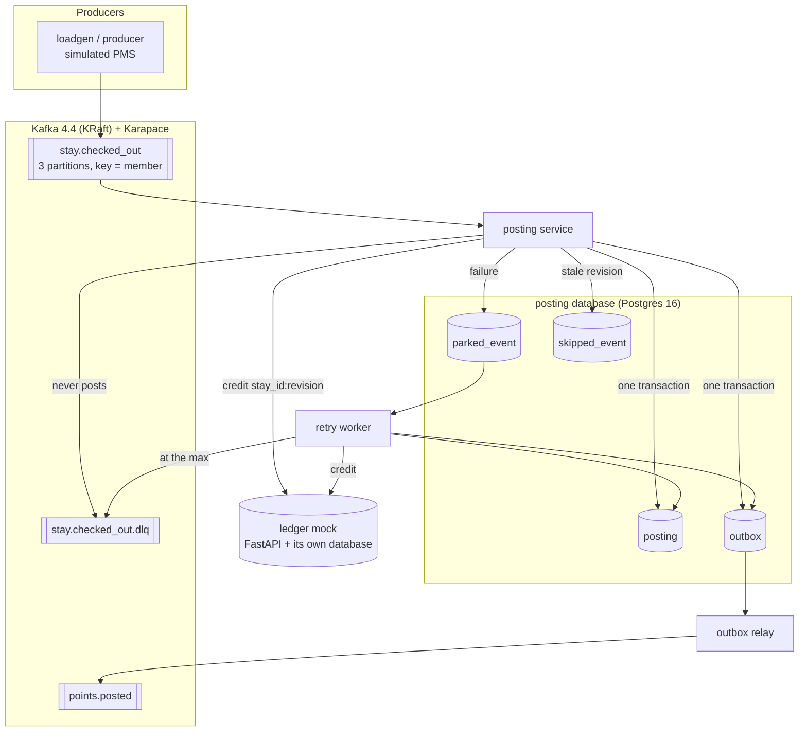

# Architecture (Milestone 2: the pipeline)

Simulated system, synthetic data, local Docker Compose (`core` profile). The investigator, tracing and the UI come in
later milestones (`docs/implementation-plan.md`).

| Component | Code | Runs as | Database rights |
|---|---|---|---|
| Producer, load generator | `app/pipeline/producer.py`, `loadgen.py`, `seed.py` | CLI | none |
| Posting service | `app/pipeline/posting.py` | `posting` container | `posting_app`: SELECT/INSERT postings, outbox, skipped events; parked events' delivery columns |
| Retry worker | `app/pipeline/retry.py` | `retry-worker` container | `posting_app` |
| Outbox relay | `app/pipeline/relay.py` | `relay` container | `posting_relay`: the outbox's delivery columns only |
| Ledger mock | `app/ledger/` | `ledger` container | `ledger_app`: SELECT/INSERT credits, no UPDATE or DELETE |
| Schema gate | `app/pipeline/schema_check.py` | CI, CLI | none |

How each piece behaves under failure: `docs/event-semantics.md`. Decisions: ADR-0010 to ADR-0018.
