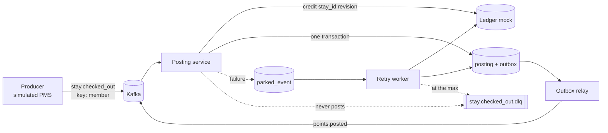

# Event semantics: what the pipeline promises, and what it doesn't

Simulated system, synthetic data (fictional hotel group `hg-demo`). Requirements PIPE-07 and PIPE-08. The decisions
behind each line are ADR-0014 to ADR-0018; the tests named here are in `tests/`.

## The short version
- **Delivery is at least once, everywhere.** A message can arrive twice; it is never silently dropped once Kafka has
  taken it.
- **Credit is exactly once per stay revision,** because the ledger refuses a second credit for one idempotency key, at
  the database level. That is idempotency, not "exactly-once delivery", which **this pipeline does not claim.**
- **Order is per member,** not global. One member's events stay in order across retries; different members' events
  can interleave.

## The path of one checkout

## Where duplicates can happen, and what stops a double credit
| Where | How a duplicate appears | What stops a double credit | Test |
|---|---|---|---|
| Producer retries | a batch is resent after a lost acknowledgement | idempotent producer (`enable.idempotence`, `acks=all`): **0 duplicates** under a fault proxy, against 37 without it (ADR-0017) | `test_producer_kafka.py::test_producer_retries_add_no_duplicates_and_keep_per_member_order` |
| An application resend | the same event sent again, the same event ID | the posting service sees the posting row (or the parked row) and reports DUPLICATE | `test_posting_kafka.py` (the same event twice) |
| A re-emitted stay | the same stay revision under a new event ID (a producer bug) | `UNIQUE(stay_id, revision)` on `posting`, and the ledger key `stay_id:revision` | `test_posting_kafka.py` (8 concurrent resends) |
| Consumer crash after the credit | the offset isn't committed, so the event is redelivered | the ledger replays the same entry for the same key and points; the posting insert is `ON CONFLICT DO NOTHING` | `test_posting_kafka.py`, `test_parking_kafka.py` (crash tests) |
| Offset commit fails after the work committed | Kafka says "waiting for coordinator" | logged and counted (`posting_offset_commit_failures_total`); the redelivery is a duplicate | `test_posting_unit.py::test_a_failed_offset_commit_is_a_warning_and_the_loop_goes_on` |
| Two retry workers | both could pick the same parked event | `FOR UPDATE SKIP LOCKED` plus a lease; marking done is fenced on the claim | `test_parking_kafka.py::test_two_workers_never_claim_the_same_parked_event_and_each_posts_once` |
| Relay crash after publish | `points.posted` is published twice | **not prevented**: readers dedupe on the record's fixed `event_id`. The ledger is not touched | `test_relay_kafka.py::test_a_crash_after_publish_before_marking_publishes_twice_and_readers_dedupe` |

**The last guard:** the ledger's `UNIQUE(idempotency_key)`, and its runtime role can't `UPDATE` or `DELETE` a credit.
Even wrong application code can't credit one stay revision twice (`tests/test_ledger_postgres.py`).

## Consumer groups and commits
- **The posting service** is one consumer group (`posting-service`). It commits an offset by hand, synchronously, for
  exactly the message it handled, and **only after** that message's database transaction (or its park, or its skip)
  committed.
- **When the database or the dead-letter topic is down,** nothing commits. The consumer seeks back to the same
  message and waits a growing, jittered time, so that partition waits.
- **Rebalances:** a partition moving to another consumer redelivers anything not committed, which is a duplicate,
  handled as above. A dedicated rebalance test is still to come (`docs/known-limitations.md`).

## Retries: parking, not retry topics (ADR-0016)
- **A failed event is parked** in Postgres (`parked_event`) with its original bytes, and its offset is committed, so
  the partition moves on. Every later event **of the same member** parks behind it, which keeps per-member order
  without blocking other members.
- **The retry worker** claims each member's oldest parked event, with backoff:

  | Failure | Counts toward dead-lettering? | Ends |
  |---|---|---|
  | transient: ledger 5xx, timeout, 429 (honouring `Retry-After`), 401 | no: an outage isn't poison | posted when the ledger is back |
  | permanent: another ledger 4xx; `original_missing` | yes | the DLQ after 5 attempts |
  | ledger 409 (the key was used with other points); undecodable | at once | the DLQ |

- **Dead-letter messages** carry the original key, value and headers, plus `error_class`, `error_detail`, `attempt`,
  `original_topic`, `original_partition`, `original_offset`, `first_failed_at` and `last_failed_at`. Nothing is
  replayed automatically: replay is M7, approved by someone other than the requester.

## Corrections and out-of-order revisions (RFC-0001 D10, ADR-0018)
A checkout can be corrected: the same stay, a higher `revision`, a new event ID. The rule, in `events.plan_credit`:

| The event | The stay's latest posted revision | What happens |
|---|---|---|
| revision 1 | none | credit the stay's points |
| revision n > 1 | m < n | credit the **signed difference** from revision m, under `stay_id:n` (it can be zero or negative) |
| any revision n | m ≥ n | **stale:** recorded in `skipped_event`, not credited |
| revision n > 1 | none | **original_missing:** parked, retried, dead-lettered after 5 attempts |

So the credits of a stay always add up to what its latest posted revision earns, whatever revisions were missed
(`tests/test_posting_unit.py::test_corrections_add_up_to_the_latest_revision_whatever_the_gaps`).

**A known cost:** when a correction arrives before its original, the original (same member) parks behind it. It posts
once the correction is dead-lettered, and the correction then needs a replay (M7).

## Schemas and their evolution
- **Format:** Avro, one committed file per topic and version (`schemas/`), through the schema registry (Karapace),
  subject `<topic>-value`.
- **Compatibility:** `BACKWARD_TRANSITIVE`. A new version must read every older version's data: add a field only with
  a default, drop a field, or widen a type (int → long).
- **The gate:** `python -m app.pipeline.schema_check` checks every committed version against every older one; with
  `--registry`, it also registers them in order and fails on a refusal. CI runs both in the integration job.
- **Unknown `schema_version` headers** are dead-lettered (`schema_version`), never guessed at.

## Partition key
- **The key is `member_number`,** on 3 partitions. One member's events share a partition, so Kafka keeps their order.
- **The cost:** a very active member makes one partition hotter than the others. That is accepted at this scale and
  noted in `docs/scaling-and-limits.md`.

## What is not claimed
- **No exactly-once delivery.** Duplicates are expected and handled.
- **No global order.**
- **No order between a correction and an original that arrive the wrong way round:** see above.
- **`points.posted` can be published twice:** readers must dedupe on its `event_id`.
