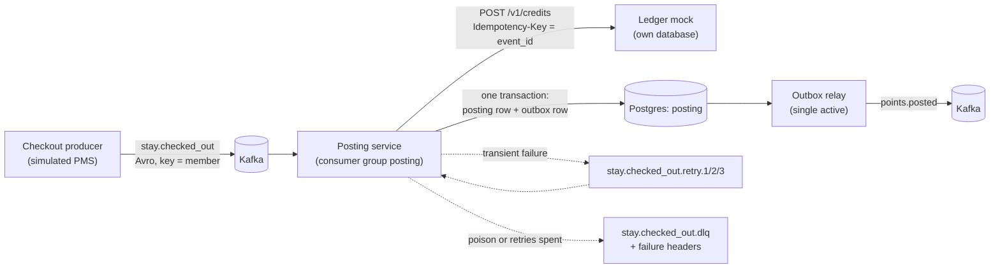

# RFC-0001: The points-posting pipeline, transactional outbox and idempotent ledger (Milestone 2)
Status: **accepted**      Milestone: 2      Author: Claude Code (Opus 5.5), for the owner      Date: 2026-11-17

**Approved by the owner on 2026-11-17, as written** (the D1–D12 recommendations). Decision record: ADR-0010.
Everything here is a simulation with synthetic data. "Live" in this document means the local Docker stack.

## Differences while building
PR-A (the stack, the ledger mock, CI), 2026-11-17:
1. **Karapace isn't the lighter image.** It is 1.72 GB. D3 had called Confluent's image "heavier", which I hadn't
   checked. The choice stands on the licence and the matching API (ADR-0010).
2. **Runtime-role passwords are two new secrets**, `LEDGER_DB_PASSWORD` and `POSTING_DB_PASSWORD`, and owner roles
   have NOLOGIN. The RFC didn't say how a service gets its password. Deriving it from the superuser password would
   have given every service the superuser password (ADR-0011).
3. **The ledger's control endpoint is switched on by `LEDGER_CONTROL_ENABLED=true`**, not by `APP_PROFILE=dev|test`.
   `APP_PROFILE` already names the preflight profile. `PUBLIC_DEMO_MODE=true` always switches control off.
4. **`localhost` is mapped to 127.0.0.1 for database connections, with a 10 s connect timeout** (ADR-0012). The first
   integration run hung on `::1`.
5. **`posting` also has `UNIQUE(stay_id, revision)`.** The ledger key is the event ID (spec B1), so a producer that
   re-emits a stay under a new event ID would credit twice. PR-B checks this business key before calling the
   ledger, and the constraint is the backstop. The remaining race goes in `docs/event-semantics.md` (PR-B).
6. **The ledger's `members` table moves to PR-C**, with the seeds. The ledger doesn't validate membership in M2.
7. **The migrations job starts only Postgres.** It bootstraps separate `ci_` roles and databases, so the same command
   is safe on the owner's machine (`scripts\ci_local.ps1`).

## Approval checklist
| # | Question | Answer | Where it's covered |
|---|---|---|---|
| 1 | Is M2 inside v1, with nothing from the spec dropped? | **Yes.** M2's rows are all v1: PIPE-01–05, PIPE-07–10, DEL-01 (core profile), DEL-03 (first CI), DEL-07, TEST-01/02 (pipeline parts). Pieces of those rows that belong to later milestones stay `Planned` with their milestone, and are listed | "Scope"; "Left for later milestones" |
| 2 | Does M2 avoid all arm and investigator code, so pre-registration (M3) still comes first? | **Yes.** M2 creates nothing under `app/arms/` or `app/investigator/`, and no failure-scenario triggers. The catalog, hypotheses, thresholds and protocol are committed in M3 before either exists, and M3's `tests/test_preregistration.py` checks that order in git history | "Scope"; "Not in M2" |
| 3 | Does everything run locally, with no money spent and no account used? | **Yes.** Kafka, the schema registry and Postgres run in Docker. No AI is used in M2 at all. GitHub Actions is free on a public repo. Cost: **$0**. Nothing uses an account beyond the repo you already own | "Money, accounts and downloads" |
| 4 | Is there no way for M2 to double-credit points, and no unapproved recovery? | **Yes.** The ledger's own table has a unique constraint on the idempotency key, and its runtime role can't update or delete. Duplicate, concurrent, crash and rebalance tests on real Kafka and Postgres each assert exactly one credit per event. M2 has **no recovery actions** (DLQ replay, re-post): those come in M7 with approval by someone other than the requester. M2 has no AI | D5, D9; "Test plan" |
| 5 | Do you need to install anything? Are the images pinned? | **Nothing to install.** Every image is pinned to an exact tag, verified on the build day and recorded in the verification log. Every Python package is pinned in `uv.lock` | "Money, accounts and downloads"; D1–D3 |
| 6 | Does git use your noreply email? | **Yes.** It's repo-local (`339370878+vamsialladev@users.noreply.github.com`) and checked with `git log --format=%ae` before every push | "Delivery" |

**Decisions for you:** D1–D12 below each carry a recommendation. Approving the RFC approves the recommendations; name
any you want changed.

## Context
Stage 9's "missing points" cases often start in the posting pipeline: "the property never transmitted the stay"
(Stage 9 `docs/root-cause-analysis.md`). Stage 10 builds that pipeline first, with no AI, so the failures in M3 and
the investigator in M6 have something real to break and to read.

Spec Part B and Part P: M2 is done when **checkout → posting → ledger works, and a duplicate-event test proves no
double credit.**

Constraints:
- Python 3.12 for every service (spec 0.4, ADR-0005).
- **No exactly-once claim.** Kafka transactions cover Kafka-to-Kafka only. They can't make a Postgres write and a
  Kafka publish atomic, and the ledger is a separate HTTP service. The safety comes from at-least-once delivery plus
  idempotency at the ledger.
- Data shapes match Stage 9 (`docs/continuity.md` §3):
  - `GR-#####` members
  - `BR-####` / `ML-####` stays
  - 10 points per US dollar on the room rate
  - `L-0000001` ledger entries
  - tenant `hg-demo`
- Stage 9's write-path lessons apply to the ledger call:
  - a 409 means something was applied under that key, so it's not "safe to re-run"
  - one "not found" is not proof
  - an uncertain outcome is resolved by a status lookup before any retry

## The flow

1. **The producer** emits `stay.checked_out`. It serializes with Avro through the schema registry, uses the
   `member_number` as the key, and adds headers: `correlation_id`, `event_id` and `schema_version`.
2. **The posting service** consumes with auto-commit off. For each event it:
   1. deserializes and validates the event
   2. computes points (pure function; room rate only)
   3. calls the ledger with `Idempotency-Key = event_id`
   4. on success, writes in **one Postgres transaction** a `posting` row (`UNIQUE(event_id)`) and an `outbox` row
      for `points.posted`
   5. commits the Kafka offset
3. **The relay** publishes outbox rows in id order with an idempotent producer (`acks=all`). It marks each row
   `published_at` after the delivery report.
4. **Failures:**
   - transient ones go to a retry topic with backoff
   - poison messages, and events that have spent their retries, go to the DLQ, with failure headers

### Where duplicates can happen (and why they don't double-credit)
| Where | How | What stops a second credit |
|---|---|---|
| Producer | Retry after a lost acknowledgement | Idempotent producer (in-session); and the ledger key |
| Consumer | Crash after the ledger credit, before the offset commit; rebalance | Ledger `UNIQUE(idempotency_key)` returns the first result; `posting.UNIQUE(event_id)` stops a second outbox row |
| Posting DB | The transaction fails after the ledger credited (catalog scenario 7) | Redelivery calls the ledger again with the same key and gets the same entry back, then the transaction is retried |
| Relay | Crash after publish, before `published_at` | `points.posted` can be published twice: **at-least-once, documented**. It carries `event_id`, so readers can dedupe |
| Retry topics | An event re-enters through a retry topic while a duplicate sits on the main topic | Same ledger key |

## Decisions (recommendation first)
**D1. Kafka broker: `apache/kafka`, the official Apache image, as a single KRaft node.**
- **Pinning:** an exact 4.x tag, the newest patch release listed on Docker Hub on the build day. Apache's Docker
  page confirms 4.1.2. The heap is capped at 512 MB for Docker Desktop.
- **Alternative:** Redpanda, which speaks the Kafka API but isn't Kafka, under the BSL licence. It stays the fallback
  only if Kafka can't run on your machine.
- **Tradeoff:** a single node means replication factor 1. That's labelled dev-only in `docs/scaling-and-limits.md`.

**D2. Python client: `confluent-kafka`** (maintained by Confluent, built on librdkafka).
- **Why:** it has an idempotent producer, manual commits, and a schema-registry client plus Avro serializers in one
  package, with Windows wheels.
- **Pinning:** the newest version on PyPI on the build day. A PyPI mirror shows 2.15.1; Confluent's docs list 2.16.0.
  `uv.lock` pins it.
- **Alternatives:**
  - `aiokafka`: no registry client, and async adds complexity a small service doesn't need
  - `kafka-python`: a patchier maintenance history
- **Tradeoff:** the API is synchronous, so each worker is a plain loop. That's easier to explain and test.

**D3. Schema registry: Karapace** (Aiven, Apache 2.0).
- **Why:** its REST API is compatible with Confluent Schema Registry, so `confluent-kafka`'s client works unchanged.
- **Alternatives:**
  - Confluent Schema Registry: the most familiar to employers, but under the source-available Confluent Community
    License (free to run locally) and a heavier JVM image
  - Apicurio: Apache 2.0, with a compatibility API
- **Switching:** because the API matches, a switch is a config change. If any incompatibility shows up in the tests,
  I'll stop and ask before switching to Confluent's registry.

**D4. Schema format: Avro, subject compatibility `BACKWARD_TRANSITIVE`.**
- **Files:** `.avsc` files under `schemas/`, one per subject and version.
- **Release gate (DEL-07):** `scripts\schema_check.ps1` (plus `python -m app.pipeline.schema_check`) asks the
  registry whether every committed schema is compatible, and CI fails if one isn't.
- **v2 schema:** `stay.checked_out` v2 adds an optional field with a default. A test proves the registry **rejects**
  a breaking change (a removed required field). That's catalog scenario 1's mechanism.
- **Alternative:** JSON Schema. It's easier to read, but registries apply compatibility to it less predictably.

**D5. Order inside the posting service: ledger credit first, then one Postgres transaction, then the offset commit.**
- **Why:** if anything fails after the credit, redelivery is harmless, because the ledger returns the same entry for
  the same key.
- **Ledger replies:**
  - a 409 (same key, different body) goes to the DLQ as `idempotency_conflict`, never retried as safe
  - a timeout triggers a status lookup: two lookups with a settle window, as in Stage 9, before any retry
- **Alternative:** write the posting and outbox first, then credit from a separate worker. That adds a third moving
  part and a second outbox.

**D6. Outbox relay: one active relay**, held by a Postgres advisory lock.
- **How it publishes:** it reads batches in id order with `FOR UPDATE SKIP LOCKED`, uses an idempotent producer with
  `acks=all`, and marks each row after its delivery report.
- **Ordering:** guaranteed per `member_number` (the partition key) because a single relay publishes in id order.
- **Second instance:** a second relay waits on the lock (hot standby). That's tested.
- **Tradeoff:** throughput is bounded by one relay. That's fine at demo rates, and the limit and the fix (shard by
  partition) go in `docs/scaling-and-limits.md`.

**D7. Topics and keys:**
- **Topics:** `stay.checked_out` and `points.posted` have 3 partitions each, replication 1, and the key
  `member_number`. Keeping one member on one partition keeps that member's events in order.
- **Cost:** a hot member can skew one partition. That's documented, not hidden.

**D8. Retries:** three retry topics, `stay.checked_out.retry.1`, `.retry.2` and `.retry.3`, with delays of 5 s, 30 s and
120 s. The delays are set in config, and the tests use milliseconds.
- **When an event is retried:** the retry consumer waits until the `not_before` header has passed, without blocking
  other partitions.
- **Error classes, decided by deterministic code:**

  | Class | Example | Route |
  |---|---|---|
  | `schema` / `validation` | Undeserializable or invalid event | DLQ now |
  | `idempotency_conflict` | 409 from the ledger | DLQ now |
  | `rate_limited` | 429 | retry, honouring `Retry-After` |
  | `ledger_unavailable` | 5xx, connection error | retry |
  | `ledger_timeout` | no reply, and the status lookups found nothing | retry |
  | `credential_expired` | 401 | retry (an operator rotates the token), then DLQ |
  | `original_missing` | a correction arrives before its original stay | retry, then DLQ |
- **DLQ headers:** `error_class`, `error_detail` (redacted), `attempt`, `original_topic`, `original_partition`,
  `original_offset`, `correlation_id`, `first_failed_at`, `last_failed_at`.

**D9. Databases:** one Postgres container (`postgres:16.15-alpine`, the same as Stage 9) holding two databases:
- `posting`: `posting`, `outbox`
- `ledger`: `credits`, `members`

Each database has its own migration-owner role and runtime role (Stage 9's lesson: an owner can always edit its own
tables).
- **Ledger runtime role:** `SELECT, INSERT` on `credits` only, with **no UPDATE or DELETE**. `UNIQUE(idempotency_key)`
  is the last guard against double credit, even if application code is wrong. That's tested as the real role.
- **Migrations:** Alembic, one tree per database.

**D10. Out-of-order corrections (needed for catalog scenario 11):** `stay.checked_out` carries `stay_id` and
`revision`, which defaults to 1.
- **A correction** (revision > 1) credits the signed difference from the latest posted revision of that stay, under
  its own `event_id`.
- **A stale revision** is recorded and skipped.
- **A correction with no original posted** is retried as `original_missing`, then sent to the DLQ.
- **Ledger amounts** can be negative for corrections only. The ledger mock records them; Stage 9 still owns member
  adjustments.

**D11. The ledger mock (FastAPI):**
- **Endpoints:**
  - `POST /v1/credits`: idempotent; the same key and body return the same entry, with `L-0000001` IDs
  - `GET /v1/credits/{idempotency_key}`: status lookup
  - `/healthz` and `/readyz`
- **Auth:** a bearer token from `LEDGER_API_TOKEN`, with an expiry time from config, so an expired token returns 401.
- **Rate limit:** a token bucket that returns 429 with `Retry-After`.
- **Latency:** configurable, so M3 can trigger timeouts.
- **Control:** a test-and-ops endpoint, off unless `APP_PROFILE=dev|test`, changes latency, limits and expiry. M3's
  triggers use it. It's local only and can't credit.

**D12. How tests reach real Kafka and Postgres: the same Docker Compose file locally and in CI**
(`docker compose --profile core up -d --wait`), not testcontainers.
- **Why:** one definition, the pinned images, and Windows-friendly behaviour. Stage 9 did the same for Postgres.
- **Integration tests** run the pipeline code in-process against the real containers. That's how a "crash" can be
  injected at an exact point (after the credit, before the commit).
- **One smoke test** runs the containerised services end to end.
- **No silent skips:** `REQUIRE_MARKERS=kafka,postgres` in CI turns any skip or missing test into a failure (M1's
  guard).

## Scope
### Built in M2
| Area | Files (planned) | Requirement IDs |
|---|---|---|
| Compose `core` profile: Kafka, Karapace, Postgres, ledger, posting, relay; topic creation; health and readiness; graceful shutdown (finish the message, commit, close) | `docker-compose.yml`, `Dockerfile`, `scripts\stack.ps1` | PIPE-01, DEL-01 (core) |
| Event schemas and the compatibility gate | `schemas/*.avsc`, `app/pipeline/schemas.py`, `app/pipeline/schema_check.py` | PIPE-02, PIPE-07, DEL-07, TEST-01 |
| Producer, with correlation IDs | `app/pipeline/producer.py` | PIPE-02 |
| Posting service: validation, points, ledger client, outbox write, error classes, retry and DLQ routing | `app/pipeline/posting.py`, `points.py`, `ledger_client.py`, `routing.py` | PIPE-03, PIPE-07 |
| Outbox relay | `app/pipeline/relay.py` | PIPE-05 |
| Ledger mock | `app/ledger/` | PIPE-04 |
| Migrations, roles, seeds | `migrations/posting/`, `migrations/ledger/`, `app/pipeline/seed.py` | PIPE-09, DEL-01 |
| Load generator, with a hard rate cap | `app/pipeline/loadgen.py` | PIPE-10 |
| First CI workflow | `.github/workflows/ci.yml`, `scripts\ci_local.ps1` (new steps) | DEL-03 (part) |
| Docs | `docs/event-semantics.md` (PIPE-07/08), `docs/architecture.md` (Mermaid), `docs/data-dictionary.md` (mapped to Stage 9's `PostingQueueItem`), `docs/scaling-and-limits.md`, `docs/tech-debt-register.md`, `docs/real-system-swap-guide.md` (lens files, kept short), ADR-0010 onward for D1–D12 | PIPE-07, PIPE-08 |

### Not in M2
- **Any AI**, and anything under `app/arms/` or `app/investigator/` (M5, M6), so M3's pre-registration stays first.
- **Failure-scenario triggers and resets**, and the catalog (M3). M2 only builds the knobs the triggers will use
  (D11).
- **Any recovery action:** DLQ replay, consumer pause and resume, outbox re-run. These come in M7, approved by someone
  other than the requester, through an audited path.
- **Tracing, metrics and dashboards** (M4). M2 logs structured JSON with `correlation_id`, so M4 can add traces
  without changing the events.

### Left for later milestones (rows stay `Planned` with their milestone)
- **DEL-03:**
  - the container scan and SBOM (M13 slice)
  - Playwright (M8)
  - lychee (M13)
- **DEL-01:** the `observability` and `full` profiles (M4), and scenario trigger and reset (M3).
- **TEST-02:** trace propagation (M4).

## Test plan
**Unit tests (offline, in `scripts\test.ps1`):**
- points calculation: room rate only, rounding, currency, revisions
- the error classifier, for every class in D8
- the retry schedule and `not_before`
- DLQ header building, with redaction
- the correction delta rule
- ledger idempotency logic: same key and body; same key, different body → 409
- token expiry and the token bucket
- Avro round-trips, v1 → v2 compatibility, and a breaking change detected locally

**Integration tests (real Kafka, Karapace and Postgres; markers `kafka`, `postgres`).** Each one ends by checking
the ledger database directly:
- no `idempotency_key` appears more than once
- the sum of credits equals the expected points

| # | Test | Proves |
|---|---|---|
| 1 | Happy path: 50 events → 50 credits → 50 `points.posted` | The M2 "done when" flow |
| 2 | **Duplicate event**: the same event published 3 times | **No double credit** (M2 "done when") |
| 3 | Concurrent duplicates: 2 consumers, same event, at the same time | The DB constraint holds under a race |
| 4 | Crash after the ledger credit, before the offset commit; restart | Redelivery gives one credit and one posting |
| 5 | Posting transaction fails after the credit; redelivery | One credit (scenario 7's mechanism) |
| 6 | Relay crash after publish, before marking | `points.posted` duplicated, as documented; the ledger is unchanged |
| 7 | Poison message | DLQ, with every header in D8; the partition keeps moving |
| 8 | 429 then success; 5xx then success | Retry topics with backoff; one credit |
| 9 | Retries spent | DLQ, `attempt = 4` |
| 10 | Timeout where the credit actually landed | The status lookup finds it; no second credit |
| 11 | 401 from an expired token | Retried, then DLQ; no credit |
| 12 | Correction before original; stale revision | Retry → DLQ as `original_missing`; the stale one is skipped |
| 13 | Rebalance: a second consumer joins mid-stream | No loss, no double credit |
| 14 | Consumer lag | Lag is measured and readable (needed by M4) |
| 15 | Breaking schema change | The registry rejects it; the CI gate fails |
| 16 | The ledger runtime role tries `UPDATE` and `DELETE` on `credits` | Refused by Postgres |
| 17 | Graceful shutdown mid-batch | The current message finishes and its offset is committed |
| 18 | Smoke test: containerised producer → posting → ledger → relay | The compose stack works end to end |

**Guards:** a test that seeds an extra credit by hand must make the no-duplicates check fail, which proves the check
can fail (rule 7).

## First CI workflow (`.github/workflows/ci.yml`)
- **Triggers and permissions:** pull requests and pushes to `main`. `permissions: contents: read` at the top, and
  nothing more. A concurrency group cancels superseded runs. Actions are pinned to full commit SHAs, with the version
  in a comment.
- **Jobs:**

  | Job | What it runs |
  |---|---|
  | `checks` | `uv sync --frozen`; ruff, ruff format check, mypy strict; unit tests with the coverage gate (80%) |
  | `integration` | `docker compose --profile core up -d --wait`; migrations; `pytest -m "kafka or postgres"` with `REQUIRE_MARKERS=kafka,postgres`; compose logs uploaded on failure |
  | `migrations` | upgrade to head → downgrade to base → upgrade, for both databases; `alembic check` for model drift |
  | `schema-gate` | registry compatibility for every committed schema (DEL-07) |
  | `secrets` | gitleaks `v8.30.1` (pinned image), refusing a scan of 0 commits |
  | `audit` | pip-audit |
- **No paid key, and no secret:** CI generates throwaway local passwords at run time. The `.env.example` names stay
  empty.

## Money, accounts and downloads
- **Cost:** $0. Nothing is deployed, and no account is created or used beyond your existing GitHub repo.
- **No AI and no Anthropic key** in M2.
- **Downloads** (sizes go in the verification log when pulled):
  - images: `apache/kafka` (exact 4.x), Karapace (exact release tag), `postgres:16.15-alpine`, `python:3.12-slim`
    (exact patch tag) as the service base
  - packages from PyPI, pinned in `uv.lock`: `confluent-kafka` (with Avro), `fastapi`, `uvicorn`, `sqlalchemy`,
    `psycopg`, `alembic`, `httpx`, `pydantic`
- **Docker Desktop memory:** about 1.5 GB for the core stack. If that's a problem on your machine, D1's heap cap is the
  knob.

## Delivery
- **Slices:** three PRs from `main`, each merged with a merge commit **only when CI is green**:
  1. **PR-A:** the compose stack, migrations and roles, the ledger mock and the first CI workflow. CI exists from
     here on.
  2. **PR-B:** the producer, posting service, outbox and relay, with tests 1–6 and 13–18.
  3. **PR-C:** retries and the DLQ, corrections, the load generator, the schema gate and the semantics docs, with
     tests 7–12 and 15.
- **PR #2:** once CI is on `main`, I'll merge `main` into PR #2 (the M1 follow-ups) so its CI runs, then merge it on
  green.
- **Every commit:** the noreply author, checked before each push; pre-commit (gitleaks, private keys, ruff);
  `scripts\secrets_scan.ps1` before each push.
- **Finish:** verification-log rows, the matrix, the status, the handoff, the teaching notes and the 3-line summary
  (rule 10).

## Risks
| Risk | Mitigation |
|---|---|
| Kafka in Docker Desktop on Windows is slow or memory-hungry | The heap cap; one broker; `--wait` health checks; Redpanda fallback (D1) only with your OK |
| Karapace and the `confluent-kafka` client disagree somewhere | Integration test 15 and the serializer round-trips show it on day one; stop and ask before switching (D3) |
| Flaky timing in retry and crash tests | Retry delays are injected, not slept; crashes are injected hooks, not timers; and no test is weakened to go green (rule 7) |
| The scope grows into M3 | No triggers, catalog or scenario names in M2; the knobs only |

## What would change this RFC
- Kafka can't run on your machine → Redpanda (D1).
- You prefer the employer-familiar registry over the open licence → Confluent Schema Registry (D3).
- The relay's throughput becomes a bottleneck in the M9 stress split → shard the relay by partition (D6).
