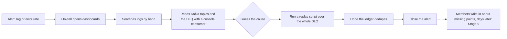
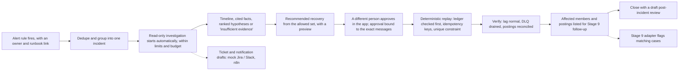

# Workflow: current and proposed (FICTIONAL)

> Fictional hotel group, simulated people, synthetic data. The current workflow is the simulated "before" that arm A
> (the manual runbook arm) reproduces in the benchmark.

## 1. Current workflow (simulated)

**Where it hurts** (hypotheses DH1–DH6 in `docs/discovery.md`):
1. Evidence is gathered by hand, from several tools.
2. The cause is guessed, not cited.
3. Replay is all or nothing, with no preview and no approval.
4. Nobody proves the ledger dedupes.
5. There's no link back to the affected members.

## 2. Proposed workflow (v1 in solid lines; v2 dashed)

## 3. Step by step (proposed)
| Step | Who or what | Deterministic or AI | Release |
|---|---|---|---|
| Alert fires | Alert rule as code | Deterministic | v1 (M4) |
| Incident created or updated (idempotent) | Automation engine | Deterministic | v1 (M8) |
| Investigation starts | Automation engine, within per-incident and per-hour limits and the daily budget | Deterministic trigger; AI reads | v1 (M8) |
| Evidence gathered and correlated | Investigator tools (read-only) + model | AI, cited | v1 (M6) |
| Fallback when the model is down | Rules correlation engine (arm B) | Deterministic | v1 (M5–6) |
| Recovery recommended | Investigator, from the allowed set only | AI recommends | v1 (M6) |
| Preview | Recovery service | Deterministic | v1 (M7) |
| Approval | A person with the `approver` role, not the requester | Human | v1 (M7–8) |
| Execution and verification | Recovery service | Deterministic | v1 (M7) |
| Affected-member list | Recovery service + investigator scope | Deterministic list; AI may summarize | v1 (M8) |
| Post-incident review draft | Investigator | AI drafts, a person edits | v1 (M8) |
| Ticket, notification, n8n | Automation engine + n8n | Deterministic | v2 (M10) |
| Stage 9 case flags | Adapter (needs a Stage 9 change) | Deterministic | v2 (M11) |

## 4. What a person still decides
- Whether to approve the recovery: always a person, and never the one who requested it.
- Whether the root cause is accepted for the post-incident review.
- Any loyalty adjustment beyond the replay. Stage 9 owns that, with its own approval flow.
